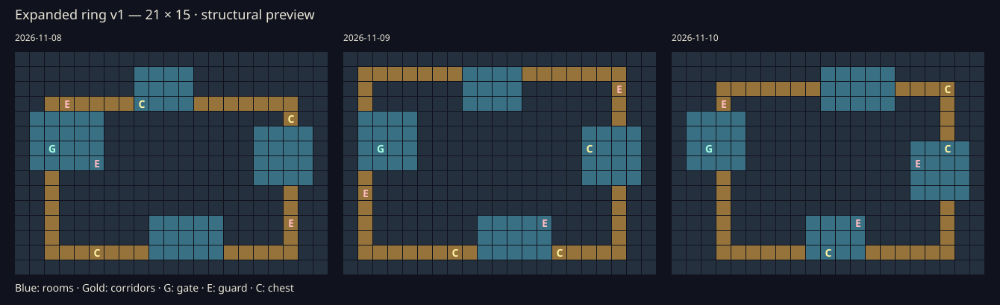

# 21×15-ös négytermes generátor

A `generateExpandedDungeon(dayId)` (src/expanded-dungeon.js) kísérleti, tiszta függvény. Visszatér: `width`, `height`, `generatorVersion`, `tiles`, `enemies`, `chests`, továbbá ellenőrzéshez `rooms` és `corridors`. A folyosórekordok `from`/`to` teremindexet és csak a termeken kívüli `cells` koordinátákat tartalmazzák. Minden hívás új objektumokat ad.

Az `expanded-ring-v1` saját generátorazonosító, nem a játék támogatott rulesVersion értéke. A seed FNV-1a a `lumenfall:expanded-ring-v1:<dayId>` szövegen; a PRNG Mulberry32, az elhelyezési sorrend és a Fisher–Yates keverés a szerződés része. A bemenet valódi YYYY-MM-DD naptári nap, hibás érték RangeError. Nincs környezeti véletlen vagy időlekérdezés.

Négy egymástól elkülönülő terem található balra, fent, jobbra és lent. Változik a teremszélesség, egyes termek magassága/helye és a folyosók nyomvonala. Négy egymezős összeköttetés zárt gyűrűt alkot. A külső keret fal; a (2,6) kapu és (1..3,5..7) érkezési terület szabad. Három őrző (6/8/10 HP) és három láda hat külön mezőre kerül, a kaputól legalább négy Manhattan-lépésre. A kevert jelöltekből először lefoglalunk egy ládát x≥17 vagy y≥13 helyen. A jobb terem garantál ilyen mezőt, ezért nincs újrapróbálkozás. A generálás korlátos, O(szélesség × magasság) munkával és memóriával fut.

## Ellenőrzés

365 napra az összes padló BFS-sel elérhető. A termek nem fednek át, a négy folyosó termeken kívüli mezői diszjunktak és csak a megfelelő terempárhoz érnek. Minden teljes folyosó eltávolítása után mind a négy terem elérhető marad: ez valódi teremközi kerülőút, nem egy szoba belső rácsciklusa. A tesztek ellenőrzik a falperemet, kaput, entitásokat, a régi határon túli mezőket, a változatosságot, a determinisztikusságot, rögzített SHA-256 ujjlenyomatot, kimeneti függetlenséget és szökőnapot is.

Újragenerálás: `node scripts/preview-expanded-dungeon.js`. Kék: termek; arany: folyosók; G: kapu; E: őrző; C: láda. Három napi térkép szerkezeti képe vizuálisan ellenőrizve. Ez nem játékmenet-, böngésző- vagy mobileszközpróba; ilyen próba nem futott.

## Integráció külön lépésben

A böngészős játék továbbra is 17×13, rulesVersion=2. A main.js és createGame nem importálja ezt a modult, a mentésellenőrzés a nagyobb térképet továbbra is elutasítja. A szabály-1/-2 generátorok és korábbi mentések változatlanok. A későbbi bekötéshez szükséges a verziózott mentésvalidálás, a régi expedíciók újragenerálás nélküli folytatása, valamint az explicit méret továbbítása a logikába, előnézetekbe, háttérbe, Canvasba és a #34 térképnézetébe. A mai PR a #34-től független main-alapú változás.
